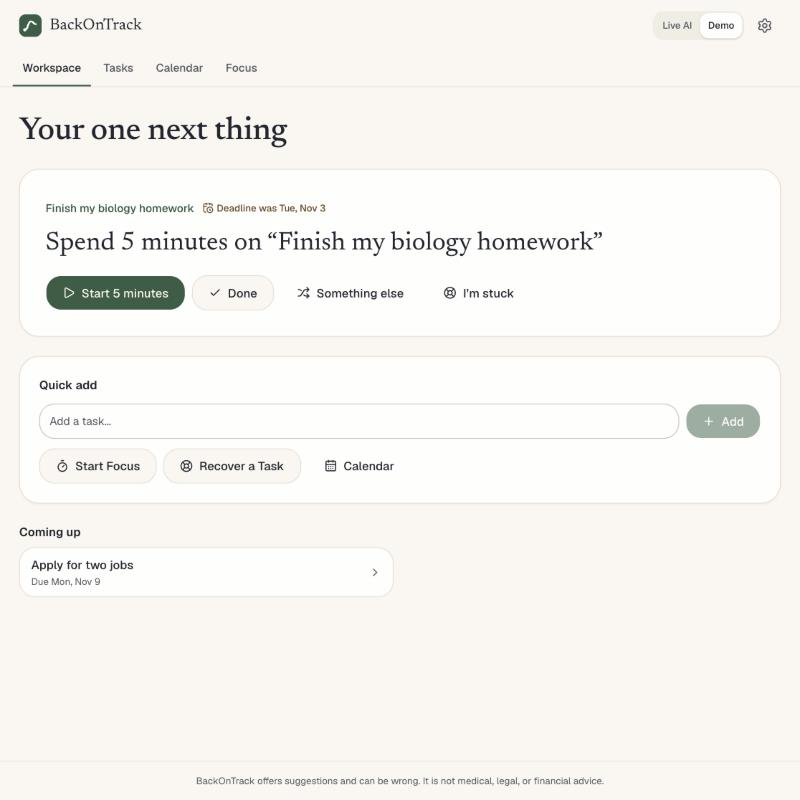
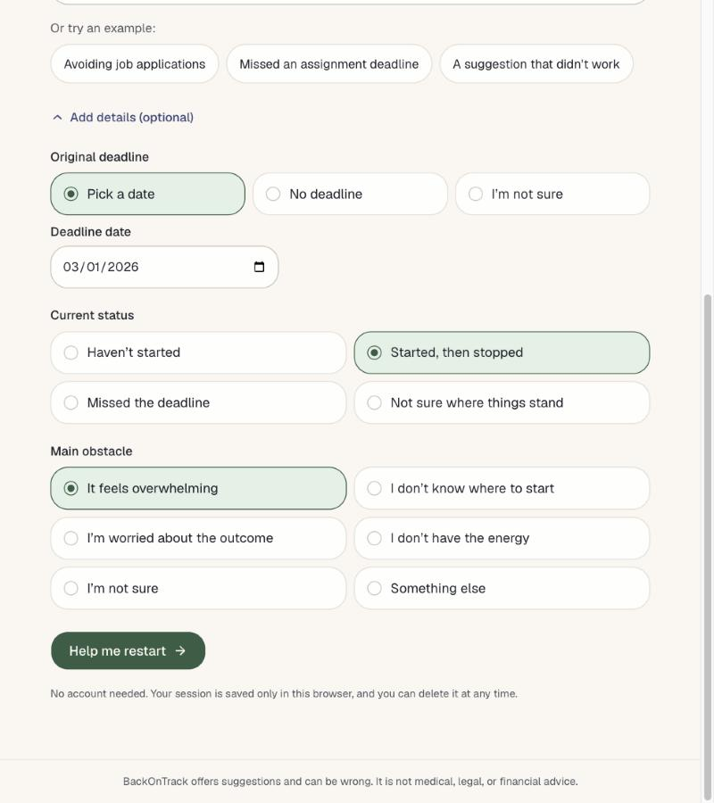

# BackOnTrack AI

**When plans fall apart, find your way forward.**

BackOnTrack AI is a functional recovery workspace: a local-first task manager, focus timer, and calendar, with an AI recovery engine for when you get stuck. It helps you get tasks done, not only think about them, and all of it except the Live AI suggestions works with no AI at all.

It was built as a prototype for the AI Lab in AIML-500: Machine Learning Fundamentals at Indiana Wesleyan University. It is not a commercial product.

**Try it:** https://backontrack-peach.vercel.app

The public site runs in Demo Mode, with no account or API key. Its suggestions come from prewritten templates, not AI, and each one is labeled that way.

## What it does

| Area | What you can do |
| --- | --- |
| **Workspace** | See one recommended next action, tasks that could use a look, upcoming deadlines, and recently finished actions. Quick add, start focus, or recover a task from here. Lists stay short, with an option to expand. |
| **Tasks** | Create, edit, delete, complete, pause, and resume tasks. Set deadlines and priority, track progress, add steps and notes, and view history. Use a list or a Kanban board with six states. |
| **Focus** | Run 5, 10, or 25 minute sessions linked to a task, with pause, resume, reset, optional breaks, and history. Timing uses wall-clock timestamps, so it stays right in background tabs and after a reload. Finishing a session never completes the task. |
| **Calendar** | See month and week views using FullCalendar's MIT packages. Deadlines look different from optional planned work. Work sessions move freely, but a deadline only moves after you confirm. "Replan" sets a new work day and leaves the deadline alone. |
| **Recovery** | When stuck, get a plan based on the task's real data: title, deadline, status, attempts, finished actions, focus sessions, and obstacles. It produces something usable, such as a draft email, worksheet, or schedule. You preview and edit it, and nothing changes unless you accept it. |

Reality Check, Finish/Reduce/Release, and Plan B are all part of Recovery. The original step-by-step wizard is still available as a guided check-in.

| | |
| --- | --- |
|  |  |
|  |  |
|  |  |

## Run it locally

Tested on Node.js 24. Next.js itself requires Node.js 20.9 or newer.

```bash
git clone https://github.com/ys3508/BackOnTrack.git
```

```bash
cd BackOnTrack
```

```bash
npm install
```

```bash
npm run dev
```

Then open http://localhost:3000. With no API key, the app runs in Demo Mode.

## Demo Mode

Tasks, focus, and the calendar never use AI, so they work the same in every mode. Demo Mode only affects suggestions:

- Recovery plans come from fixed templates filled in with the task's own details, and every plan says it's prewritten, not AI-generated.
- It runs entirely in the browser, so nothing is sent to a server.
- If Live AI repeats itself or fails, the app says so. A template is never labeled as AI output.

## Environment variables

Live AI is optional. To enable it, copy `.env.example` to `.env.local` and set one key:

| Variable | Purpose |
| --- | --- |
| `ANTHROPIC_API_KEY` | Anthropic API key. Uses `claude-haiku-5-5`, chosen as an inexpensive model ($0.10 / $0.50 per million input / output tokens when written). |
| `AI_GATEWAY_API_KEY` | Vercel AI Gateway key, used only if the Anthropic key is empty. |
| `AI_MODEL` | Optional override of the model ID. |

Keys are read only on the server and are never sent to the browser. `.env*` files are excluded from Git, except for `.env.example`.

## Testing

```bash
npm test
```

```bash
npm run typecheck
```

```bash
npm run lint
```

```bash
npm run build
```

To run the required scenarios against the real model (needs a key, and spends a small amount of credit):

```bash
npm run test:live
```

Results are in [docs/TEST_RESULTS.md](docs/TEST_RESULTS.md).

## Deploy on Vercel

The prototype is already deployed at https://backontrack-peach.vercel.app, and new commits on `main` redeploy it automatically. To create your own deployment:

1. Import `ys3508/BackOnTrack` at https://vercel.com/new. Vercel detects Next.js, so the defaults work.
2. Optionally, add `ANTHROPIC_API_KEY` under Settings → Environment Variables. Without it, the deployed app runs in Demo Mode.
3. Deploy. If you add a key later, redeploy so that it takes effect.

Set a monthly spend limit with your AI provider before sharing a live link. The built-in rate limits are per server instance, so they are not a strict quota.

## Technology

Next.js 16, React 19, TypeScript, Tailwind CSS 4, shadcn/ui components on Base UI, the Vercel AI SDK, Zod, FullCalendar (MIT packages), dnd-kit, and Vitest with Testing Library and axe-core.

## Open-source attribution

The project started from [shadcn-ui/chatbot-template](https://github.com/shadcn-ui/chatbot-template) (MIT License, © 2026 shadcn). See [THIRD_PARTY_NOTICES.md](THIRD_PARTY_NOTICES.md).

The calendar uses FullCalendar's MIT packages, and the board uses dnd-kit (MIT). Other projects were reviewed but no code was copied from them, including two that were left out because of licensing or timing approach. [THIRD_PARTY_NOTICES.md](THIRD_PARTY_NOTICES.md) has the full list.

The chat interface was removed. The workspace, recovery engine, demo content, and interface design are specific to this project.

This repository does not yet have its own license for the original BackOnTrack code. That choice belongs to the author.

## Known limitations

- The real AI model has not been tested, and the public site doesn't use it. See [docs/TEST_RESULTS.md](docs/TEST_RESULTS.md).
- No formal user testing has been done, and BackOnTrack's effect on procrastination has not been measured.
- Data stays in one browser. Clearing browser data deletes it, so use Export in Settings to keep a copy. Importing an export isn't supported yet.
- The timer stays accurate, but it can't alert you with a sound or notification when it ends.
- Calendar items are hard to read on a phone-width month view. Tapping a day lists its items in full below the calendar.
- Demo Mode uses fixed templates, so it can't respond to the details of a task the way an AI model could.
- Vague-advice, repeat, and high-stakes checks use wording rules, so they can miss cases or flag them wrongly.
- BackOnTrack is not medical, legal, financial, or mental-health advice.

## Documentation

- [Bot design](docs/BOT_DESIGN.md)
- [Design thinking](docs/DESIGN_THINKING.md)
- [Development log](docs/DEVELOPMENT_LOG.md)
- [Privacy and ethics](docs/PRIVACY_AND_ETHICS.md)
- [Test results](docs/TEST_RESULTS.md)
