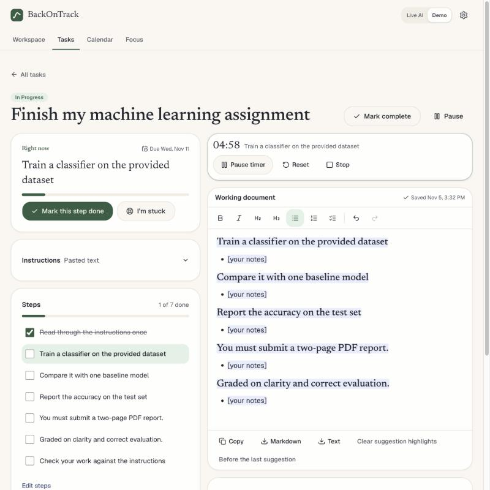
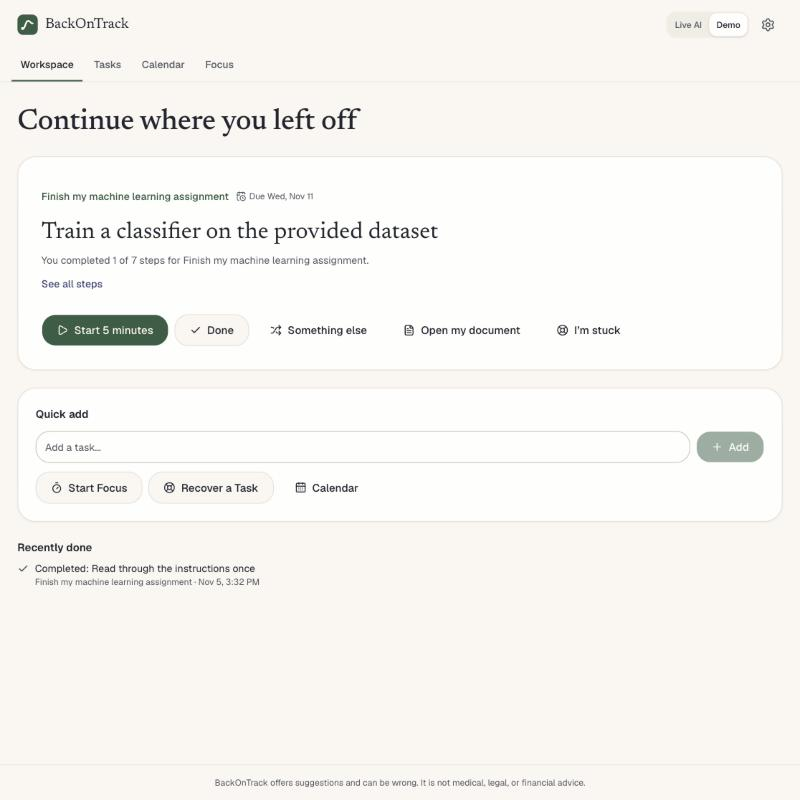
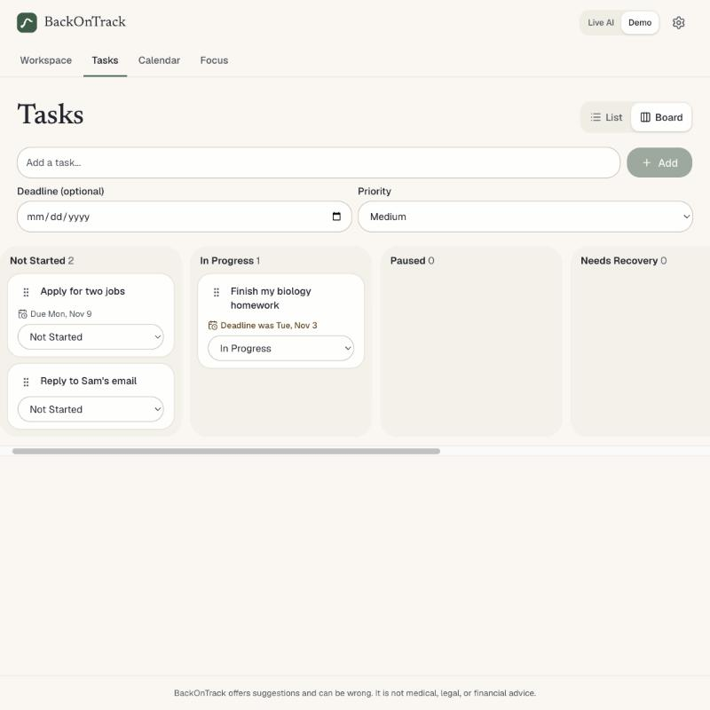
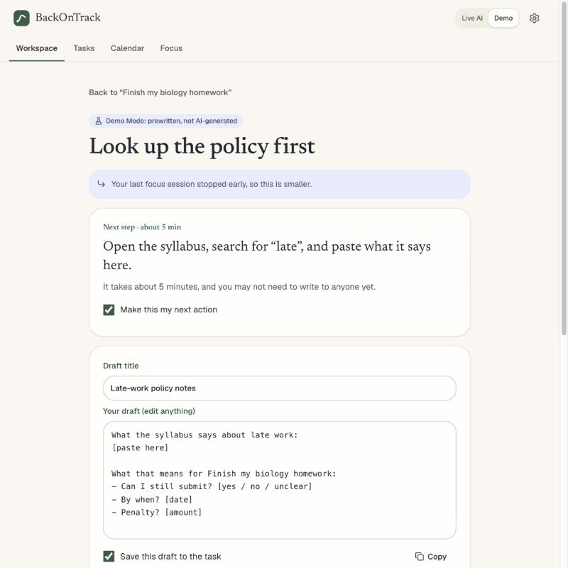
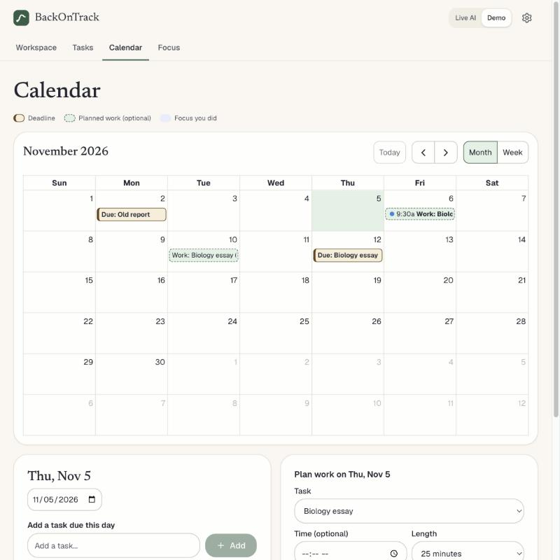
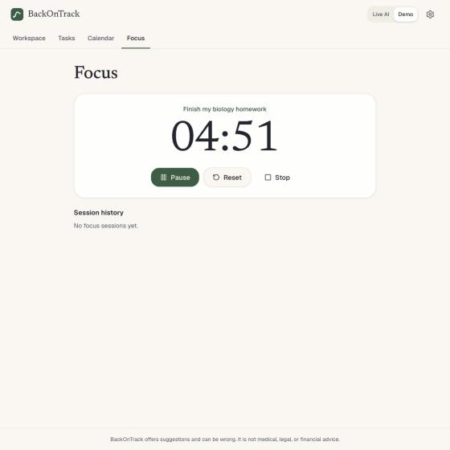

# BackOnTrack AI

**When plans fall apart, find your way forward.**

BackOnTrack AI helps you do avoided work, in one place: "Less planning. Less switching between apps. More actual progress." Each task opens as a workspace with its instructions, small steps, a working document, and a focus timer, with AI help for when you get stuck. Everything except the Live AI suggestions works with no AI at all.

It was built as a prototype for the AI Lab in AIML-500: Machine Learning Fundamentals at Indiana Wesleyan University. It is not a commercial product.

**Try it:** https://backontrack-peach.vercel.app

The public site runs in Demo Mode, with no account or API key. Its suggestions come from prewritten templates, not AI, and each one is labeled that way. The site currently runs the previous version, until the `feat/task-execution` branch is merged into `main`.

## The idea

**A task manager that adapts when life doesn't go according to plan.**

Most task managers ask "What do you need to do?" BackOnTrack keeps asking "Given what happened, what's the most realistic plan now?" It's meant for people who tend to put things off or find it hard to get started: you plan, don't do it, feel pressure, avoid the app, and find it harder to restart. It focuses on:

- **Deciding what to do:** a suggested order that explains itself, and a plan for what today can realistically hold.

- **Zero-Start:** the work is prepared, so you never begin from a blank page.
- **Failure-aware:** when an approach doesn't work, the next one is different and smaller.
- **Easy return:** you can come back after weeks away without catching up on anything.

BackOnTrack isn't a treatment for ADHD or anything else, and its effect hasn't been measured.

## What it does

BackOnTrack is a failure-aware action system. Most tools help you plan. This one is for what happens when you can't start, abandon something, or the plan stops working: **Plan → Start → Get Stuck → Recover → Continue.**

Open **Today** and the **Now card** shows one next action with one main button. It adapts to what's true right now: something coming up, a session running or paused, a planned start that has passed, or nothing scheduled.

When you're stuck, or you've been avoiding something you never scheduled, recovery happens right there in the card. It asks "What's making this difficult right now?":

| What's in the way | What you get |
| --- | --- |
| "I know what to do, but I can't start" | One 2 to 5 minute action, with Start. |
| "I don't know where to begin" | One first step, with the next ones only when you ask. |
| "I'm worried about the outcome or someone's reaction" | Reality Gap: Known Facts, Worries / Assumptions, Unknowns, and Possible Actions, all editable. It never invents a policy or consequence. |
| "I don't have enough time anymore" | Finish, Reduce, or Release. Release says plainly that it only changes BackOnTrack and doesn't cancel anything outside it. |

Each ends in a Plan B: an action you can edit, a short time, and Start. A missed block can also move to a buffer or be rescheduled, and neither ever changes a hard deadline. Ending a session asks where to pick up next time, and whether you made progress, met the minimum version, or finished the original task, which stay separate. "Restarted" counts sessions that really began, never cards that were looked at.

The navigation is Today, Calendar, Routines, and Settings. All tasks and focus history are linked from Today.

| Area | What you can do |
| --- | --- |
| **Suggested order** | Tasks are ordered by deadline, priority, progress, and plans, with the reason shown. You can turn this off, and change a task's priority or time estimate. |
| **Learning what helps** | BackOnTrack notices when work stalls, such as getting stuck on empty documents, and whether accepted help was followed by progress. Then it changes which help comes first, and says why. It needs at least 3 separate moments before claiming anything. In Settings, you can see every record, say "This isn't right", delete anything, state a preference, or switch it off. |
| **Coming back** | After a few days away, Today shows one way back in, leading with the note you left yourself. It shows no overdue counts, backlog, or streaks. |
| **Zero-Start** | "Set up my workspace" prepares a document with what's being asked, questions to answer, an outline, and an editable first section. Choose where to begin, and the first [placeholder] is selected so you can type over it. It's structure, not research. |
| **Help starting** | Each step has "Help me do this", which gives one concrete first action and something to start from: an outline, a draft, a checklist, or code to copy. Code hasn't been run, and BackOnTrack can't run it. A new task can set up its first workspace from your instructions. "Start 5 minutes" opens the document for that step, with a small timer on top. |
| **Task workspace** | Add instructions by pasting them or uploading a PDF, .txt, or .md file. Get an editable breakdown into small steps. Write in a rich-text document with autosave, and get writing help you preview, then accept or reject. Keep the timer beside your work. |
| **Tasks** | Create, edit, delete, complete, pause, and resume tasks. Set deadlines and, if you want, a priority, track progress, add steps and notes, and view history. Use a list or a Kanban board with six states. |
| **Focus** | Run 5, 10, or 25 minute sessions linked to a task, with pause, resume, reset, optional breaks, and history. A session stopped in under a minute is an interrupted attempt, and doesn't count as focus time. Timing uses wall-clock timestamps, so it stays right in background tabs and after a reload. Finishing a session never completes the task. |
| **Calendar** | Day (the default, opening at the current time), Week, Month, and a Year heatmap of focus. Click a month day to add a task. In Day and Week, click a slot for a session of your last-used length, or drag across slots for any length, then type to find a task or name a new one. Drag to move, and use the bottom grip to resize. Click a block for Start focus, Done, Change time, Open, Open link, and Delete. Planned work is dashed, real focus is solid, deadlines are chips, and flexible work sits in the untimed row. Past items are never red. |
| **Buffers** | Time kept free for catching up, by default 30 minutes at 3:00 PM. Set the number, the length, and an optional gap between work blocks in Settings. Unused buffers never count as missed. |
| **Routines** | Fixed or flexible, with an optional minimum version. Each occurrence can be ● Full, ◐ Minimum, or skipped, and these are counted apart. Edit one occurrence or all future ones. No streaks. |
| **Reminders** | Optional, about five minutes before a scheduled block. They only work while BackOnTrack is open in a tab, and aren't push notifications. |
| **Calendar export** | A one-time `.ics` file of upcoming planned blocks and deadlines. There's no syncing. |

| | |
| --- | --- |
|  |  |
|  |  |
|  |  |

## Run it locally

Tested on Node.js 24. Next.js itself requires Node.js 20.9 or newer.

```bash
git clone https://github.com/ys3508/BackOnTrack.git
```

```bash
cd BackOnTrack
```

```bash
npm install
```

```bash
npm run dev
```

Then open http://localhost:3000. With no API key, the app runs in Demo Mode.

## Demo Mode

Tasks, focus, and the calendar never use AI, so they work the same in every mode. Demo Mode only affects suggestions:

- Breakdowns, writing help, and recovery plans come from fixed templates and simple text rules, using the task's own details. Each one says it's prewritten, not AI-generated.
- Four made-up examples are available on an empty workspace: a homework assignment, a job application, a missed deadline, and a first attempt that failed.
- It runs entirely in the browser, so nothing is sent to a server.
- If Live AI repeats itself or fails, the app says so. A template is never labeled as AI output.

## Environment variables

Live AI is optional. To enable it, copy `.env.example` to `.env.local` and set one key:

| Variable | Purpose |
| --- | --- |
| `ANTHROPIC_API_KEY` | Anthropic API key. Uses `claude-haiku-5-5`, chosen as an inexpensive model ($0.10 / $0.50 per million input / output tokens when written). |
| `AI_GATEWAY_API_KEY` | Vercel AI Gateway key, used only if the Anthropic key is empty. |
| `AI_MODEL` | Optional override of the model ID. |

Keys are read only on the server and are never sent to the browser. `.env*` files are excluded from Git, except for `.env.example`.

## Testing

```bash
npm test
```

```bash
npm run typecheck
```

```bash
npm run lint
```

```bash
npm run build
```

To run the required scenarios against the real model (needs a key, and spends a small amount of credit):

```bash
npm run test:live
```

Results are in [docs/TEST_RESULTS.md](docs/TEST_RESULTS.md).

## Deploy on Vercel

The prototype is already deployed at https://backontrack-peach.vercel.app, and new commits on `main` redeploy it automatically. To create your own deployment:

1. Import `ys3508/BackOnTrack` at https://vercel.com/new. Vercel detects Next.js, so the defaults work.
2. Optionally, add `ANTHROPIC_API_KEY` under Settings → Environment Variables. Without it, the deployed app runs in Demo Mode.
3. Deploy. If you add a key later, redeploy so that it takes effect.

Set a monthly spend limit with your AI provider before sharing a live link. The built-in rate limits are per server instance, so they are not a strict quota.

## Technology

Next.js 16, React 19, TypeScript, Tailwind CSS 4, shadcn/ui components on Base UI, the Vercel AI SDK, Zod, Tiptap, PDF.js, FullCalendar (MIT packages), dnd-kit, and Vitest with Testing Library and axe-core.

## Open-source attribution

The project started from [shadcn-ui/chatbot-template](https://github.com/shadcn-ui/chatbot-template) (MIT License, © 2026 shadcn). See [THIRD_PARTY_NOTICES.md](THIRD_PARTY_NOTICES.md).

The editor uses Tiptap (MIT), PDF reading uses PDF.js (Apache-2.0), the calendar uses FullCalendar's MIT packages, and the board uses dnd-kit (MIT). Other projects were reviewed but no code was copied from them, including two that were left out because of licensing or timing approach. [THIRD_PARTY_NOTICES.md](THIRD_PARTY_NOTICES.md) has the full list.

The chat interface was removed. The workspace, recovery engine, demo content, and interface design are specific to this project.

This repository does not yet have its own license for the original BackOnTrack code. That choice belongs to the author.

## Known limitations

- Reminders depend on an open browser tab, and browsers can delay them in the background. There's no push service, so a closed tab means no reminder.
- The `.ics` file has only been checked for correct format by tests, not imported into a real calendar app.
- Buffer times are fixed slots (3 PM, then 5 PM, 11 AM, and 7 PM). You choose how many and how long, not when.
- Recovery cases are saved only in this browser, along with everything else. Clearing browser data deletes them, so use Export in Settings to keep a backup.
- In Demo Mode, the blocker suggestion, errand detection, Reality Gap sorting, and next steps come from wording rules and templates. They handle any text, but only generally, and can sort a sentence wrongly. Everything is editable, and each suggestion says it isn't AI.
- Crisis wording is matched by rules, so it can miss phrasing or misfire. Live AI can flag it too, and someone who isn't in danger can continue. BackOnTrack is not a crisis service.
- The Live AI recovery stage has only been tested against a mocked model, not a real one.
- The suggested order uses fixed rules with chosen weights, not AI, and the weights haven't been tested with users. Time estimates are rough, and steps without an estimate are assumed to take 25 minutes.
- Learning what helps is simple counting, and hasn't been tried with real use over time. Progress after some help doesn't prove that the help caused it.
- BackOnTrack hasn't been tried on a real assignment yet. See the real-case test in [docs/DESIGN_THINKING.md](docs/DESIGN_THINKING.md).
- The real AI model has not been tested, and the public site doesn't use it. See [docs/TEST_RESULTS.md](docs/TEST_RESULTS.md).
- No formal user testing has been done, and BackOnTrack's effect on procrastination has not been measured.
- Data stays in one browser, within its storage limit of about 5 MB. Clearing browser data deletes it, so use Export in Settings to keep a backup. The app warns if storage fills up.
- Two tabs open on the same task can overwrite each other's document changes.
- PDFs must contain real text. Scanned PDFs, images, and Word files aren't read.
- The timer stays accurate, but it can't alert you with a sound or notification when it ends.
- Calendar items are hard to read on a phone-width month view, and there's no longer a list of a day's items below the calendar.
- Dragging on the calendar was tested with a mouse, not on a touch screen. Blocks open with Enter from the keyboard, and "Add to" a day, "Schedule" in the tray, and "Change time" in a popover replace dragging, but drag-select has no keyboard version.
- The calendar shows 6 AM to 11 PM, stretching only for things outside those hours. To add something earlier or later, add it and change its start time in the popover.
- Week view has no prompt words on narrow columns, only ✓ and ✕, and its bars show focus only, not planned time.
- The calendar always opens on Day, and doesn't remember the last view.
- Demo Mode uses fixed templates and simple text rules, so it can't understand a task or explain text the way an AI model could.
- Vague-advice, repeat, and high-stakes checks use wording rules, so they can miss cases or flag them wrongly.
- BackOnTrack is not medical, legal, financial, or mental-health advice.

## Documentation

- [Bot design](docs/BOT_DESIGN.md)
- [Design thinking](docs/DESIGN_THINKING.md)
- [Development log](docs/DEVELOPMENT_LOG.md)
- [Privacy and ethics](docs/PRIVACY_AND_ETHICS.md)
- [Test results](docs/TEST_RESULTS.md)
