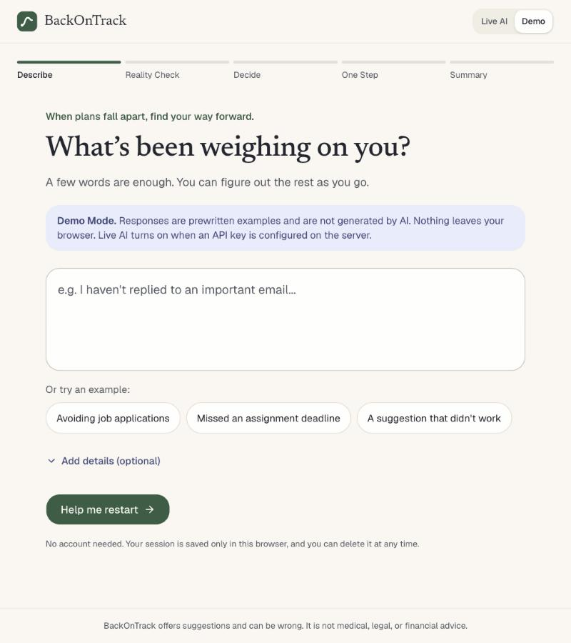
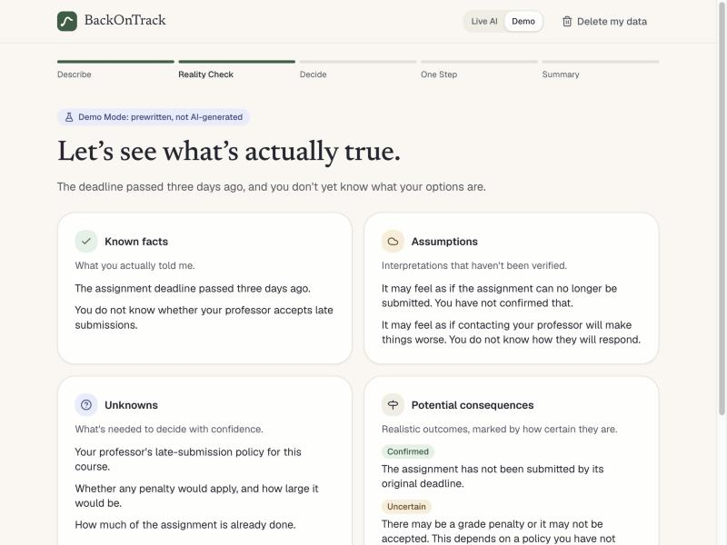
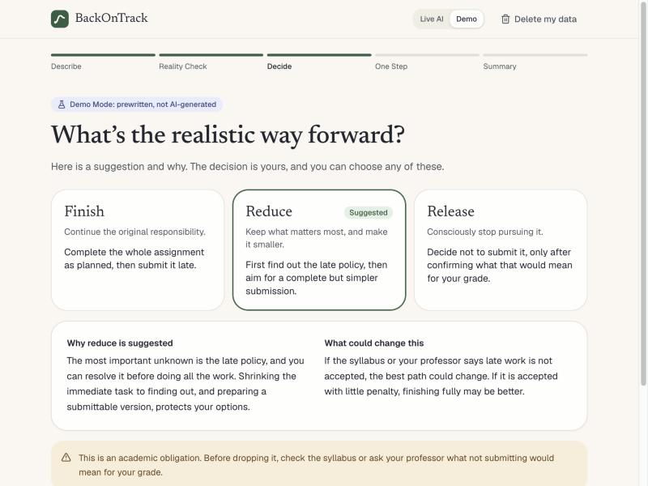
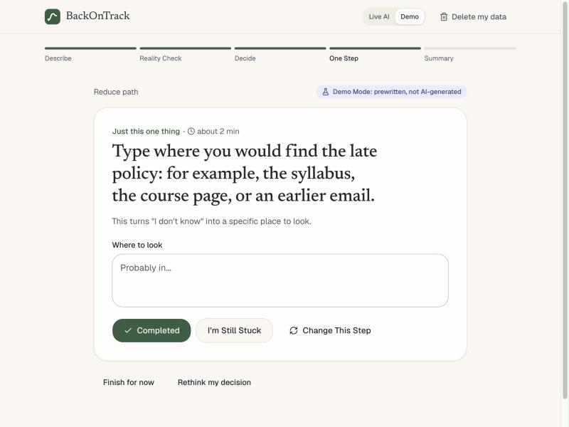
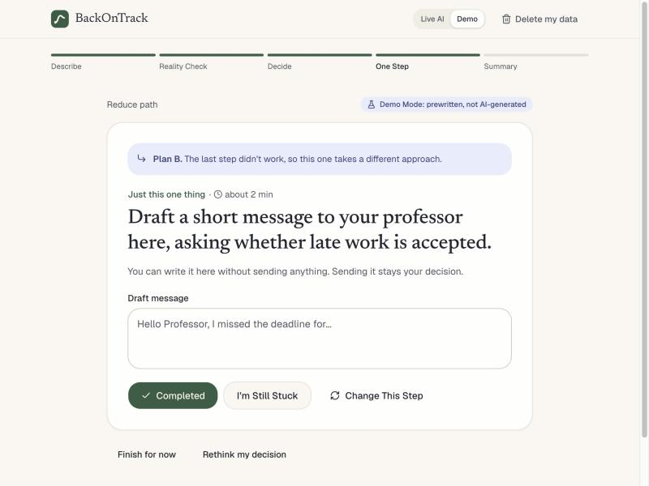
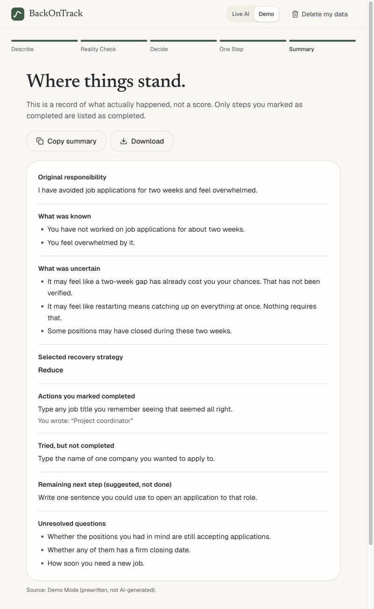

# BackOnTrack AI

**When plans fall apart, find your way forward.**

BackOnTrack AI is a failure-aware recovery assistant. Most productivity tools respond to missed plans with overdue lists, reminders, or a new plan. BackOnTrack helps a person work out what is actually true, decide what to do about it, and restart with one realistic action.

It was built as a prototype for the AI Lab in AIML-500: Machine Learning Fundamentals at Indiana Wesleyan University. It is not a commercial product.

**Try it:** https://backontrack-peach.vercel.app

The public site runs in Demo Mode, so its responses are prewritten and not AI-generated. No account or API key is needed.

## How it works

| Stage | What happens |
| --- | --- |
| 1. Recovery Intake | "What's been weighing on you?" A few words are enough. Three samples are available, no account is needed, and optional details are one click each. |
| 2. Reality Check | Separates known facts, assumptions, unknowns, and potential consequences (confirmed or uncertain). |
| 3. Recovery Decision | Suggests **Finish**, **Reduce**, or **Release**, with reasoning and uncertainty. The user can choose any of them. |
| 4. One-Step Workspace | Shows exactly one small action, with a text box and **Completed**, **I'm Still Stuck**, and **Change This Step**. |
| 5. Failure-Aware Plan B | When a step fails, the next one must take a different approach. The server checks this. |
| 6. Recovery Summary | Records only what really happened. It can be copied or downloaded. |

| | |
| --- | --- |
|  |  |
|  | |
|  |  |
|  |  |

## Run it locally

Tested on Node.js 24. Next.js itself requires Node.js 20.9 or newer.

```bash
git clone https://github.com/ys3508/BackOnTrack.git
```

```bash
cd BackOnTrack
```

```bash
npm install
```

```bash
npm run dev
```

Then open http://localhost:3000. With no API key, the app runs in Demo Mode.

## Demo Mode

Demo Mode lets anyone try the whole workflow with no API key and no cost.

- It has three scenarios: job applications, a missed assignment, and a suggestion that did not work. All three strategies and Plan B work in each one.
- Its responses are **prewritten, not AI-generated**, and every screen says so.
- It runs entirely in the browser, so nothing is sent to a server.
- If you type your own text, you get a general example that quotes your words and states that it has not analyzed them.

## Environment variables

Live AI is optional. To enable it, copy `.env.example` to `.env.local` and set one key:

| Variable | Purpose |
| --- | --- |
| `ANTHROPIC_API_KEY` | Anthropic API key. Uses `claude-haiku-5-5`, chosen as an inexpensive model ($0.10 / $0.50 per million input / output tokens when written). |
| `AI_GATEWAY_API_KEY` | Vercel AI Gateway key, used only if the Anthropic key is empty. |
| `AI_MODEL` | Optional override of the model ID. |

Keys are read only on the server and are never sent to the browser. `.env*` files are excluded from Git, except for `.env.example`.

## Testing

```bash
npm test
```

```bash
npm run typecheck
```

```bash
npm run lint
```

```bash
npm run build
```

To run the required scenarios against the real model (needs a key, and spends a small amount of credit):

```bash
npm run test:live
```

Results are in [docs/TEST_RESULTS.md](docs/TEST_RESULTS.md).

## Deploy on Vercel

The prototype is already deployed at https://backontrack-peach.vercel.app, and new commits on `main` redeploy it automatically. To create your own deployment:

1. Import `ys3508/BackOnTrack` at https://vercel.com/new. Vercel detects Next.js, so the defaults work.
2. Optionally, add `ANTHROPIC_API_KEY` under Settings → Environment Variables. Without it, the deployed app runs in Demo Mode.
3. Deploy. If you add a key later, redeploy so that it takes effect.

Set a monthly spend limit with your AI provider before sharing a live link. The built-in rate limits are per server instance, so they are not a strict quota.

## Technology

Next.js 16, React 19, TypeScript, Tailwind CSS 4, shadcn/ui components on Base UI, the Vercel AI SDK, Zod, and Vitest with Testing Library.

## Open-source attribution

The project started from [shadcn-ui/chatbot-template](https://github.com/shadcn-ui/chatbot-template) (MIT License, © 2026 shadcn). See [THIRD_PARTY_NOTICES.md](THIRD_PARTY_NOTICES.md).

[albertkupperdev/sapling](https://github.com/albertkupperdev/sapling) was the first choice but has no license, so none of its code was used. See [docs/DEVELOPMENT_LOG.md](docs/DEVELOPMENT_LOG.md).

The chat interface was removed. The recovery workflow, AI logic, demo content, and interface design are specific to this project.

This repository does not yet have its own license for the original BackOnTrack code. That choice belongs to the author.

## Known limitations

- The real AI model has not been tested, and the public site doesn't use it. See [docs/TEST_RESULTS.md](docs/TEST_RESULTS.md).
- Demo Mode has fixed content and cannot respond to the specifics of what someone types.
- The repeat check compares wording and approach labels. It reduces repetition, but it cannot prove that two steps are meaningfully different.
- Safety and high-stakes checks combine keyword matching with the model's judgment, so they can miss cases or flag them wrongly.
- Sessions are saved in one browser only. Nothing syncs between devices.
- No formal user testing has been done, and BackOnTrack's effect on procrastination has not been measured.
- BackOnTrack is not medical, legal, financial, or mental-health advice.

## Documentation

- [Bot design](docs/BOT_DESIGN.md)
- [Design thinking](docs/DESIGN_THINKING.md)
- [Development log](docs/DEVELOPMENT_LOG.md)
- [Privacy and ethics](docs/PRIVACY_AND_ETHICS.md)
- [Test results](docs/TEST_RESULTS.md)
